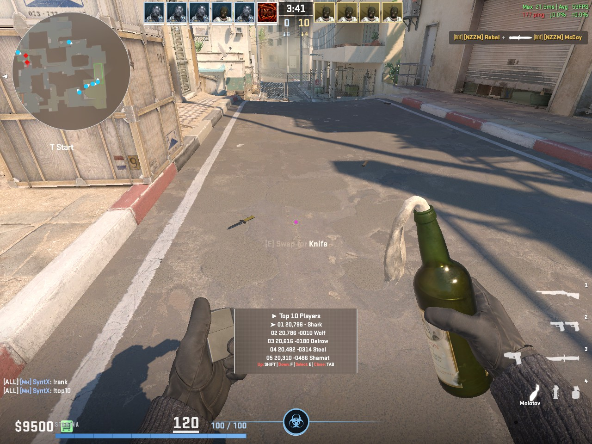
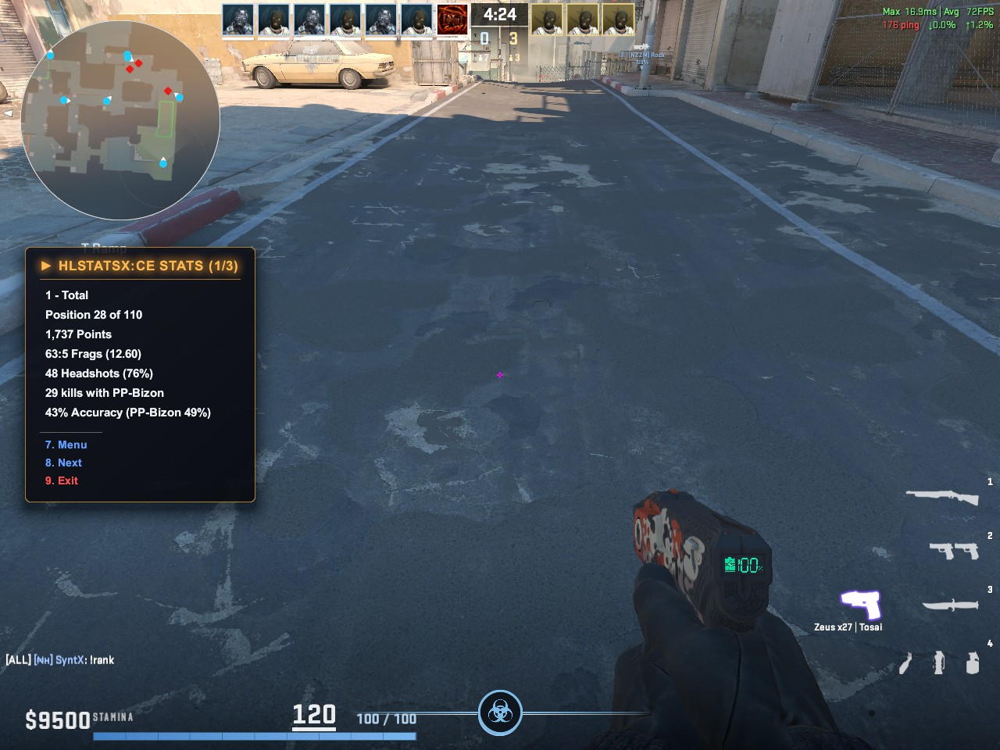
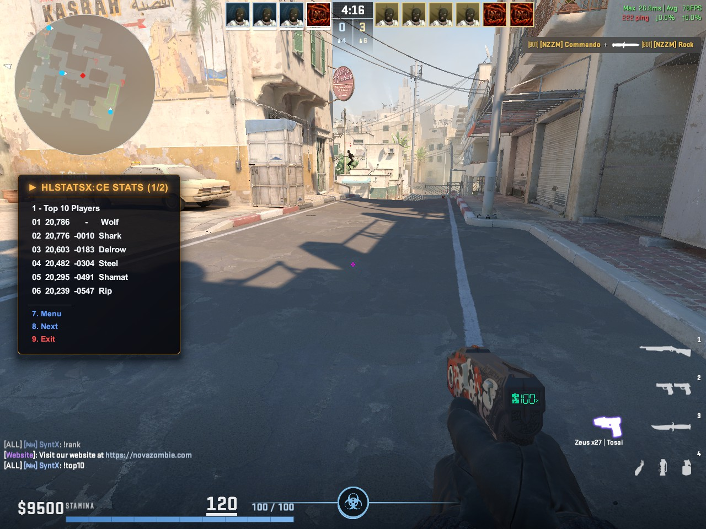
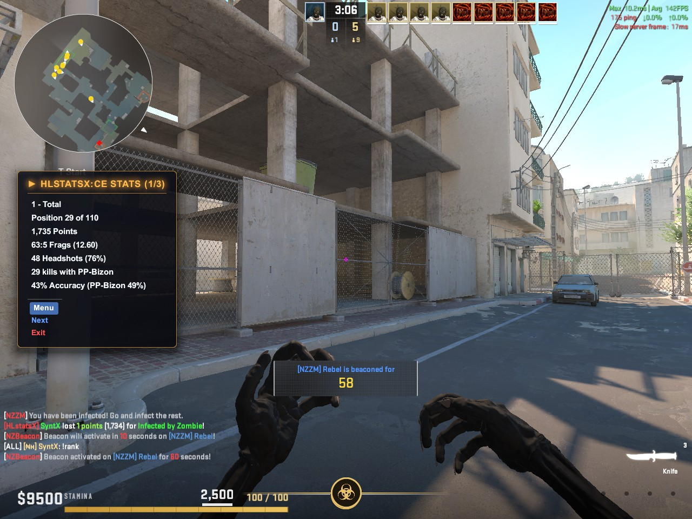
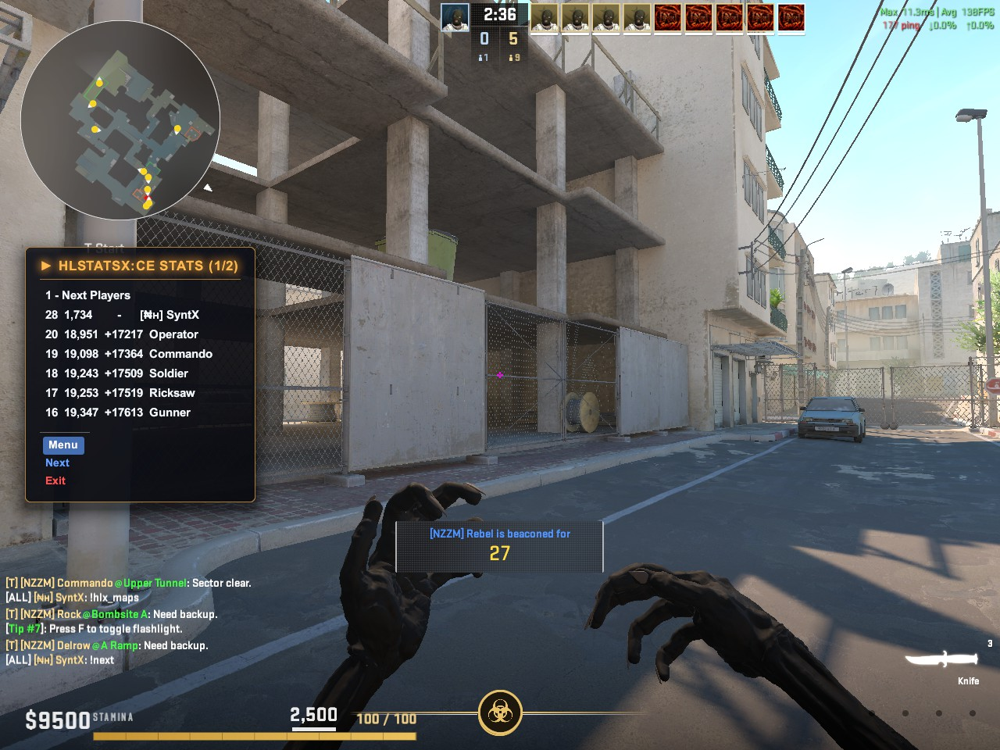
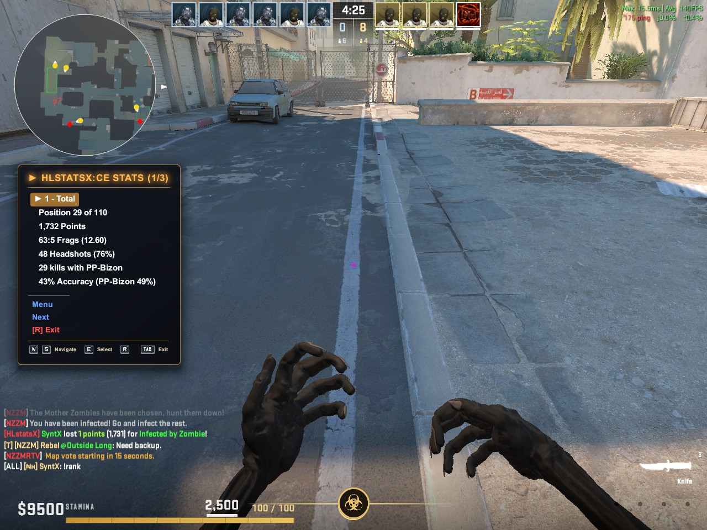
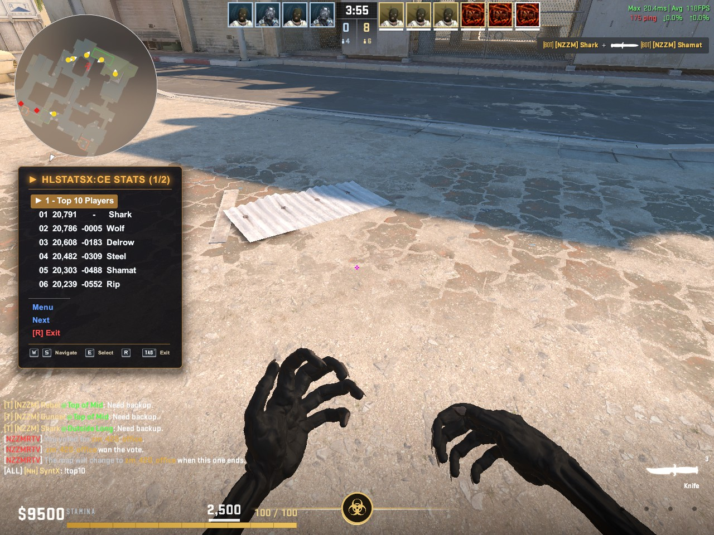

  <h1><strong>HLStatsX:CE Ingame Plugin (SwiftlyS2)</strong></h1>
  <h3>Counter-Strike 2 Echtzeit-Statistiken &amp; Panorama-HUD-Integration</h3>

  

    
    
    
    
    
    
  

  

    <b>Autor:</b> <a href="https://steamcommunity.com/id/SyntX34">SyntX34</a> |
    <b>Discord:</b> <code>nh_syntx</code> |
    <b>Steam:</b> <a href="https://steamcommunity.com/id/SyntX34">SyntX34 Profil</a>
  

  

    <b>Sprachen:</b>
    🇬🇧 <a href="../../HLStatsX/README.md">English</a> ·
    🇩🇪 <a href="de.md">Deutsch</a> ·
    🇩🇰 <a href="da.md">Dansk</a> ·
    🇪🇸 <a href="es.md">Español</a> ·
    🇫🇷 <a href="fr.md">Français</a> ·
    🇫🇮 <a href="fi.md">Suomi</a> ·
    🇭🇺 <a href="hu.md">Magyar</a> ·
    🇷🇺 <a href="ru.md">Русский</a> ·
    🇨🇳 <a href="chi.md">中文</a> ·
    🇯🇵 <a href="ja.md">日本語</a> ·
    🇰🇷 <a href="kor.md">한국어</a>
  

---

## 📌 Überblick

Dieses Plugin verbindet **Counter-Strike 2** Dedicated Server mit [SwiftlyS2](https://github.com/swiftly-solution/swiftlys2) mit dem **HLstatsX:CE** Perl-Daemon und der Web-Statistikoberfläche.

Es bietet bidirektionale UDP-Kommunikation, vollständiges Waffen-/Trefferzonen-/Aktions-Tracking, Live-`ClanTag`-Synchronisation und **4 wählbare Ingame-Menümodi** (SwiftlyS2 Built-In, Panorama Keypress, Panorama Clickable und Panorama Scrollable).

> 📖 **Hilfe bei Einrichtung oder Fehlersuche?** Siehe das **[Setup &amp; Debug Wiki](../WIKI.md)**.

---

## ✨ Funktionen

- **🎮 Vollständiges Stats-Tracking**: Kills, Headshots, Treffer, Genauigkeit, Trefferzonen, Suizide, Teamkills, Bomben-/Geisel-Events, MVPs und Live-`ClanTag`-Synchronisation.
- **💬 Chat-Befehlsabfang**: Fängt `!rank`, `!top10`, `!top20`, `!next`, `!session`, `!statsme`, `!weapons`, `!accuracy`, `!targets`, `!kills`, `!actions`, `!mapstats`, `!clans`, `!servers`, `!status`, `!help` und Waffencodes (`!ak47`, `!awp`, etc.) sauber ab.
- **📊 4 Menümodi (`MenuType`)**:
  - `1` — **Built-In**: Natives SwiftlyS2 `Core.Menu` (keine Client-Downloads nötig).
  - `2` — **Keypress**: Eigenes Panorama-HUD mit `1–7` Auswahl, `7/8` Zurück/Weiter, `9` Schließen.
  - `3` — **Clickable**: Eigenes Panorama-HUD mit voller Maussteuerung.
  - `4` — **Scrollable**: Eigenes Panorama-HUD mit `W`/`S` Navigation, `A`/`D` Seiten, `E` Auswählen, `R` Schließen.
- **🖥️ CSAY &amp; TSAY**: Zentrierte (`hlx_sm_csay`) und oben-links (`hlx_sm_tsay`) HUD-/Chat-Ankündigungen.

---

## 🖼️ Menü-Vorschau

### 1. Built-In Menü (`MenuType = 1`)
| Rank | Top 10 | Next Players |
| :---: | :---: | :---: |
|  |  |  |

### 2. Custom Panorama Keypress (`MenuType = 2`)
| Hauptmenü | Rank | Top 10 |
| :---: | :---: | :---: |
|  |  |  |

### 3. Custom Panorama Clickable (`MenuType = 3`)
| Hauptmenü | Rank | Top 10 |
| :---: | :---: | :---: |
|  |  |  |

### 4. Custom Panorama Scrollable (`MenuType = 4`)
| Hauptmenü | Rank | Top 10 |
| :---: | :---: | :---: |
|  |  |  |

---

## 🚀 Schnellstart

1. Lade die neueste `HLStatsX-vX.X.X.zip` herunter und entpacke sie nach `csgo/addons/swiftlys2/plugins/HLStatsX/`.
2. Bearbeite `csgo/addons/swiftlys2/configs/plugins/HLStatsX/config.toml` (`DaemonHost`, `DaemonPort`, `ServerIp`, `ServerPort`, `ReceiverPort`, `MenuType`).
3. Stelle im HLstatsX Web-Admin den Server-**Mod** auf **`SWIFTLYS2`**.
4. Für `MenuType = 2, 3 oder 4`: Steam-Workshop-Objekt **`3791366113`** einbinden.
