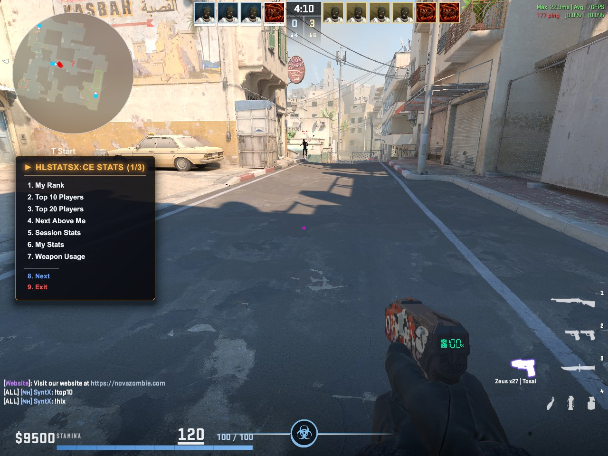
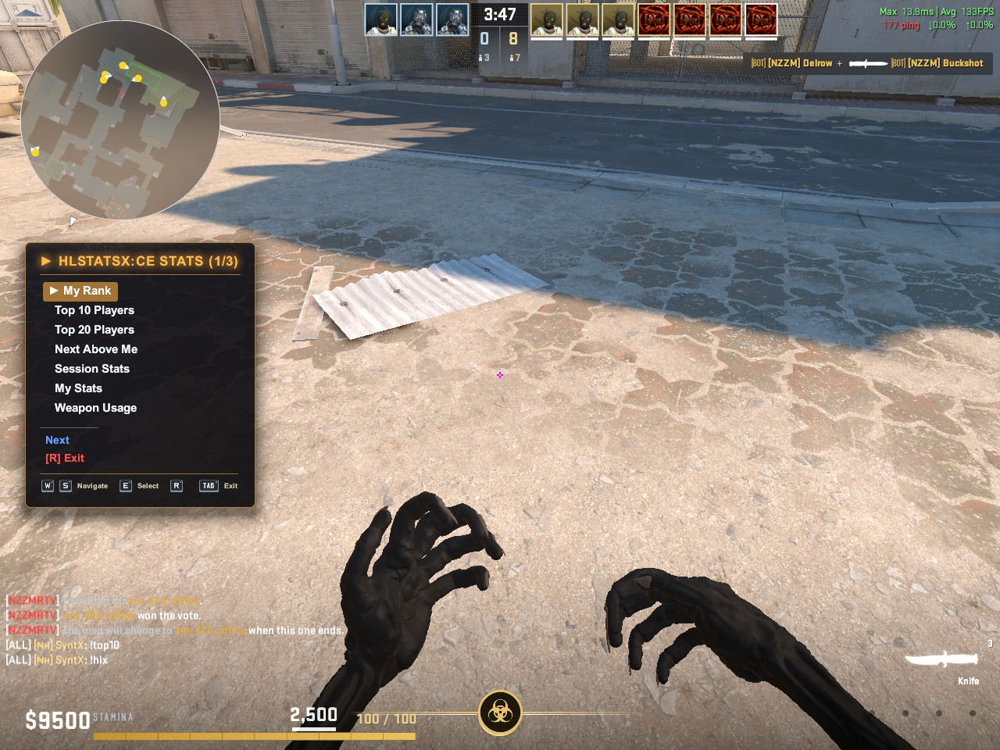

  <h1><strong>HLStatsX:CE Ingame Plugin (SwiftlyS2)</strong></h1>
  <h3>Statistiques en Temps Réel Counter-Strike 2 &amp; Intégration Panorama HUD</h3>

  

    
    
    
    
    
    
  

  

    <b>Auteur :</b> <a href="https://steamcommunity.com/id/SyntX34">SyntX34</a> |
    <b>Discord :</b> <code>nh_syntx</code> |
    <b>Steam :</b> <a href="https://steamcommunity.com/id/SyntX34">Profil SyntX34</a>
  

  

    <b>Langues :</b>
    🇬🇧 <a href="../../HLStatsX/README.md">English</a> ·
    🇩🇪 <a href="de.md">Deutsch</a> ·
    🇩🇰 <a href="da.md">Dansk</a> ·
    🇪🇸 <a href="es.md">Español</a> ·
    🇫🇷 <a href="fr.md">Français</a> ·
    🇫🇮 <a href="fi.md">Suomi</a> ·
    🇭🇺 <a href="hu.md">Magyar</a> ·
    🇷🇺 <a href="ru.md">Русский</a> ·
    🇨🇳 <a href="chi.md">中文</a> ·
    🇯🇵 <a href="ja.md">日本語</a> ·
    🇰🇷 <a href="kor.md">한국어</a>
  

---

## 📌 Présentation

Ce plugin relie les serveurs dédiés **Counter-Strike 2** utilisant [SwiftlyS2](https://github.com/swiftly-solution/swiftlys2) au démon Perl **HLstatsX:CE** et à l'interface web.

Il offre une communication UDP bidirectionnelle, un suivi complet des statistiques, une synchronisation en direct du `ClanTag` et **4 modes de menu** (SwiftlyS2 Built-In, Panorama Keypress, Panorama Clickable et Panorama Scrollable).

> 📖 **Besoin d'aide pour l'installation ou le débogage ?** Consultez le **[Wiki d'Installation et de Débogage](../WIKI.md)**.

---

## ✨ Fonctionnalités

- **🎮 Suivi Complet** : Éliminations, headshots, coups, précision, zones touchées, suicides, teamkills, bombe/otages, MVP et `ClanTag` en direct.
- **💬 Commandes Chat** : Intercepte `!rank`, `!top10`, `!top20`, `!next`, `!session`, `!statsme`, `!weapons`, `!accuracy`, `!targets`, `!kills`, `!actions`, `!mapstats`, `!clans`, `!servers`, `!status`, `!help`, etc.
- **📊 4 Modes de Menu (`MenuType`)** :
  - `1` — **Built-In** : Menu natif `Core.Menu` de SwiftlyS2 (aucun téléchargement requis).
  - `2` — **Keypress** : Panorama HUD personnalisé (`1–7` sélectionner, `7/8` Précédent/Suivant, `9` Quitter).
  - `3` — **Clickable** : Panorama HUD personnalisé avec interaction complète à la souris.
  - `4` — **Scrollable** : Panorama HUD personnalisé (`W`/`S` naviguer, `A`/`D` pages, `E` sélectionner, `R` quitter).

---

## 🖼️ Aperçus des Menus

| Built-In (`MenuType = 1`) | Keypress (`MenuType = 2`) | Clickable (`MenuType = 3`) | Scrollable (`MenuType = 4`) |
| :---: | :---: | :---: | :---: |
|  |  |  |  |

---

## 🚀 Démarrage Rapide

1. Téléchargez `HLStatsX-vX.X.X.zip` et extrayez-le dans `csgo/addons/swiftlys2/plugins/HLStatsX/`.
2. Configurez `csgo/addons/swiftlys2/configs/plugins/HLStatsX/config.toml`.
3. Dans HLstatsX Web Admin, définissez le **Mod** du serveur sur **`SWIFTLYS2`**.
4. Pour `MenuType = 2, 3 ou 4`, montez l'objet Steam Workshop **`3791366113`**.
