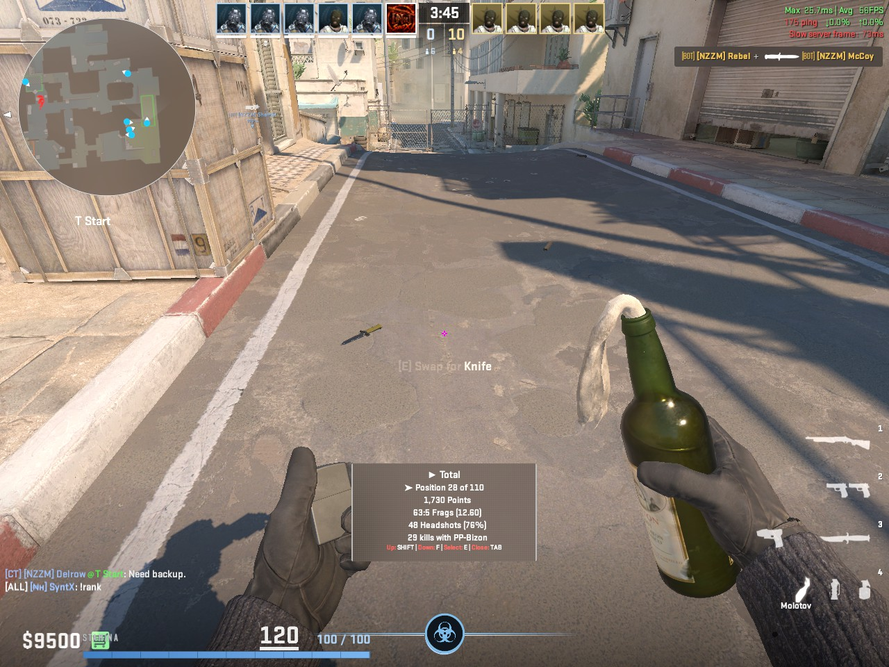

  <h1><strong>HLStatsX:CE Ingame Plugin (SwiftlyS2)</strong></h1>
  <h3>Counter-Strike 2 リアルタイム統計 &amp; Panorama HUD 連携</h3>

  

    
    
    
    
    
    
  

  

    <b>作者:</b> <a href="https://steamcommunity.com/id/SyntX34">SyntX34</a> |
    <b>Discord:</b> <code>nh_syntx</code> |
    <b>Steam:</b> <a href="https://steamcommunity.com/id/SyntX34">SyntX34 プロフィール</a>
  

  

    <b>言語:</b>
    🇬🇧 <a href="../../HLStatsX/README.md">English</a> ·
    🇩🇪 <a href="de.md">Deutsch</a> ·
    🇩🇰 <a href="da.md">Dansk</a> ·
    🇪🇸 <a href="es.md">Español</a> ·
    🇫🇷 <a href="fr.md">Français</a> ·
    🇫🇮 <a href="fi.md">Suomi</a> ·
    🇭🇺 <a href="hu.md">Magyar</a> ·
    🇷🇺 <a href="ru.md">Русский</a> ·
    🇨🇳 <a href="chi.md">中文</a> ·
    🇯🇵 <a href="ja.md">日本語</a> ·
    🇰🇷 <a href="kor.md">한국어</a>
  

## 📌 概要

このプラグインは、[SwiftlyS2](https://github.com/swiftly-solution/swiftlys2) を使用した **Counter-Strike 2** 専用サーバーと **HLstatsX:CE** Perl デーモンおよび Web 統計を連携させます。

> 📖 **セットアップやデバッグのヘルプが必要ですか？** **[セットアップ・デバッグ Wiki](../WIKI.md)** をご覧ください。

## ✨ 主な機能

- **🎮 完全な統計トラッキング**: キル、ヘッドショット、命中、命中率、部位別ヒット、爆弾/人質イベント、MVP、リアルタイム `ClanTag` 同期。
- **💬 チャットコマンド**: `!rank`, `!top10`, `!top20`, `!next`, `!session`, `!statsme`, `!weapons`, `!accuracy`, `!targets`, `!kills`, `!actions`, `!mapstats`, `!clans`, `!servers`, `!status`, `!help`。
- **📊 4つのメニューモード (`MenuType`)**:
  - `1`: **Built-In** (SwiftlyS2 標準 `Core.Menu`、クライアントダウンロード不要)。
  - `2`: **Keypress** (カスタム Panorama HUD: `1–7` 選択、`7/8` 前へ/次へ、`9` 終了)。
  - `3`: **Clickable** (カスタム Panorama HUD: マウスクリック対応)。
  - `4`: **Scrollable** (カスタム Panorama HUD: `W`/`S` 移動、`A`/`D` ページ、`E` 選択、`R` 終了)。

## 🖼️ メニュープレビュー

| Built-In (`MenuType = 1`) | Keypress (`MenuType = 2`) | Clickable (`MenuType = 3`) | Scrollable (`MenuType = 4`) |
| :---: | :---: | :---: | :---: |
|  |  |  |  |
