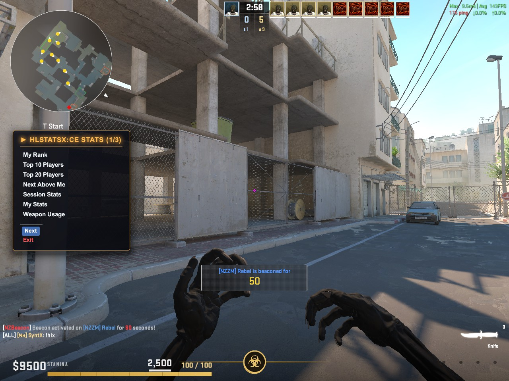

  <h1><strong>HLStatsX:CE Ingame Plugin (SwiftlyS2)</strong></h1>
  <h3>Статистика Counter-Strike 2 в реальном времени и интеграция Panorama HUD</h3>

  

    
    
    
    
    
    
  

  

    <b>Автор:</b> <a href="https://steamcommunity.com/id/SyntX34">SyntX34</a> |
    <b>Discord:</b> <code>nh_syntx</code> |
    <b>Steam:</b> <a href="https://steamcommunity.com/id/SyntX34">Профиль SyntX34</a>
  

  

    <b>Языки:</b>
    🇬🇧 <a href="../../HLStatsX/README.md">English</a> ·
    🇩🇪 <a href="de.md">Deutsch</a> ·
    🇩🇰 <a href="da.md">Dansk</a> ·
    🇪🇸 <a href="es.md">Español</a> ·
    🇫🇷 <a href="fr.md">Français</a> ·
    🇫🇮 <a href="fi.md">Suomi</a> ·
    🇭🇺 <a href="hu.md">Magyar</a> ·
    🇷🇺 <a href="ru.md">Русский</a> ·
    🇨🇳 <a href="chi.md">中文</a> ·
    🇯🇵 <a href="ja.md">日本語</a> ·
    🇰🇷 <a href="kor.md">한국어</a>
  

## 📌 Обзор

Этот плагин связывает выделенные серверы **Counter-Strike 2** на базе [SwiftlyS2](https://github.com/swiftly-solution/swiftlys2) с демоном **HLstatsX:CE** (Perl) и веб-статистикой.

> 📖 **Нужна помощь с установкой или отладкой?** Откройте **[Вики по настройке и отладке](../WIKI.md)**.

## ✨ Возможности

- **🎮 Полный учет статистики**: убийства, хедшоты, попадания, точность, зоны попаданий, события бомбы и заложников, MVP и синхронизация `ClanTag` в реальном времени.
- **💬 Перехват команд чата**: `!rank`, `!top10`, `!top20`, `!next`, `!session`, `!statsme`, `!weapons`, `!accuracy`, `!targets`, `!kills`, `!actions`, `!mapstats`, `!clans`, `!servers`, `!status`, `!help`.
- **📊 4 режима меню (`MenuType`)**:
  - `1`: **Built-In** (встроенное меню SwiftlyS2 `Core.Menu`, без загрузки файлов клиентом).
  - `2`: **Keypress** (пользовательский Panorama HUD: `1–7` выбор, `7/8` Назад/Далее, `9` Выход).
  - `3`: **Clickable** (пользовательский Panorama HUD с полным управлением мышью).
  - `4`: **Scrollable** (пользовательский Panorama HUD: `W`/`S` навигация, `A`/`D` страницы, `E` выбор, `R` выход).

## 🖼️ Примеры меню

| Built-In (`MenuType = 1`) | Keypress (`MenuType = 2`) | Clickable (`MenuType = 3`) | Scrollable (`MenuType = 4`) |
| :---: | :---: | :---: | :---: |
|  |  |  |  |
